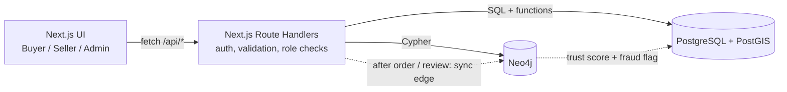

# Vicinia: Hyperlocal Marketplace

Buy and sell secondhand items **nearby**, from sellers you can trust.

Vicinia treats **location** and **trust** as two different problems and stores each in the database that fits it:

| Problem | Database | Why |
|---|---|---|
| Listings, orders, reviews, nearby search | **PostgreSQL + PostGIS** | Transactions, constraints, row locking, GiST spatial index |
| Trust, "who bought from whom", fraud rings | **Neo4j** | Trust is relational: multi-hop paths and cycle detection |

The web app is **Next.js** (React + API Route Handlers) with role-based views for **Buyers, Sellers and Admins**.

DBMS Mini Project (PES University, Experiential Learning Level 3).

---

## Features

- **Proximity search** with `ST_DWithin` and a GiST index, filtered by price, category and seller rating, ranked by seller score and distance
- **Race-safe purchase**: two buyers cannot both win the same item (`SELECT ... FOR UPDATE`, selectable isolation level)
- **Dynamic seller score** from ratings, return rate, reply time and graph trust, maintained by triggers and used in search ranking
- **Graph trust**: "I trust this seller" edges, multi-hop trust propagation, personalised trust shown on listings
- **Fraud detection**: closed buying cycles among sellers with no outside buyers are flagged as collusion rings and demoted
- **Pricing hints** for sellers (demand vs supply nearby), **delivery-time estimate** by zone, and "buyers like you also bought from" recommendations
- **Role-based access** (Buyer / Seller / Admin) enforced in every API route, with bcrypt-hashed passwords and signed session cookies

## Architecture



PostgreSQL is the source of truth for users, orders and reviews. After a purchase or review, the API mirrors it into Neo4j. Graph results (trust score, fraud flag) flow back into `seller_metrics`, which feeds the seller score used in search ranking.

---

## Prerequisites

| Tool | Version | Check |
|---|---|---|
| Node.js | **20.6 or newer** | `node -v` |
| npm | comes with Node | `npm -v` |
| Docker Desktop | any recent | `docker --version` (open Docker Desktop and wait until it says it is running) |
| Git | any | `git --version` |

You do **not** need to install PostgreSQL or Neo4j yourself, because Docker runs both.

## Setup

Run every command from the project's root folder (the one containing `package.json`).

### 1. Clone

```bash
git clone https://github.com/Spoorthi-Poornachandra/Vicinia---DBMS-Mini-Project
cd Vicinia---DBMS-Mini-Project
```

### 2. Create your `.env`

| Windows (Command Prompt) | Mac / Linux / Git Bash |
|---|---|
| `copy .env.example .env` | `cp .env.example .env` |

Open `.env` and change these three values. Any values work as long as they are consistent:

```
PG_PASSWORD=choose_a_password
NEO4J_PASSWORD=choose_a_password_of_8_or_more_characters
JWT_SECRET=any_long_random_text_at_least_16_characters
```

Leave the other values as they are. `.env` is git-ignored and must never be committed.

### 3. Start the databases

```bash
docker compose up -d
```

The first run downloads the images, which can take a few minutes. On the first start PostgreSQL **automatically runs** `db/postgres/01_schema.sql`, `02_functions.sql` and `03_seed.sql` (tables, functions, triggers and demo data).

Check that both containers are running:

```bash
docker compose ps
```

Wait about 30 seconds for Neo4j to finish starting.

### 4. Install the app's packages

```bash
npm install
```

### 5. Load the Neo4j graph

```bash
npm run db:seed-neo4j
```

You should see `ok 1/…` lines and finally `Neo4j seeded.` If it cannot connect, wait 20 more seconds and run it again.

### 6. Run the app

```bash
npm run dev
```

Open **http://localhost:3000**.

To stop: press `Ctrl+C` in the app terminal, then `docker compose stop`. To start again later: `docker compose start`, then `npm run dev`.

---

## Demo accounts

All accounts use the password **`password123`**.

| Email | Role | Notes |
|---|---|---|
| `admin@vicinia.test` | Admin | Dashboard, collusion scan, moderation |
| `ravi@vicinia.test`, `meera@vicinia.test`, `karthik@vicinia.test` | Buyer | Search, buy, review, trust |
| `suresh@vicinia.test`, `divya@vicinia.test`, `imran@vicinia.test` | Seller | List items, fulfil orders, see score |
| `alpha@vicinia.test`, `beta@vicinia.test`, `gamma@vicinia.test` | Seller | **Planted collusion ring** for the fraud demo |

### What each role can do

| Action | Buyer | Seller | Admin |
|---|:---:|:---:|:---:|
| Search and view listings | yes | yes | yes |
| Buy a listing | yes | yes (not their own) | no |
| Review a delivered order | yes | yes | no |
| Mark trust in another user | yes | yes | no |
| Create / reprice / remove own listings | no | yes | no |
| Mark orders delivered | no | yes | no |
| Run collusion scan, view flagged sellers, remove their listings | no | no | yes |

Anything outside a role's permissions returns HTTP 401 (not logged in) or 403 (wrong role).

## Demo walkthrough

1. **Spatial search:** log in as `ravi@vicinia.test`, search "couch" with a 5 km radius, and look at the distance and trust score on each card.
2. **Race condition:** run `node --env-file=.env tests/concurrency.mjs` (see Tests below). Exactly one of two simultaneous buyers wins.
3. **Seller score:** as `meera` buy something from `suresh`. As `suresh`, open **Sell** and mark it delivered. As `meera`, open **My orders** and leave a 1-star review. Log back in as `suresh` and watch the seller score drop.
4. **Trust graph:** as `ravi`, open a listing from `divya` and click **I trust this seller**. The "Your network" line on listings updates.
5. **Fraud detection:** log in as `admin@vicinia.test`, open **Admin**, and click **Run collusion scan**. Alpha, Beta and Gamma are flagged and their scores drop. Search again as `ravi` and their cheap listings sink in the ranking.

---

## Tests

The tests need the databases to be running (steps 3 and 5).

**SQL tests** (11 checks, rolled back afterwards, so your data stays unchanged). Use your own `PG_USER` and `PG_DATABASE` from `.env` if you changed them:

| Windows (Command Prompt) | Mac / Linux / Git Bash |
|---|---|
| `docker compose exec -T postgres psql -U vicinia -d vicinia < tests\sql_tests.sql` | `docker compose exec -T postgres psql -U vicinia -d vicinia < tests/sql_tests.sql` |

Expect `PASS` notices for T1 to T11.

**Concurrency test** (two buyers, one item):

```bash
node --env-file=.env tests/concurrency.mjs
```

Expect `PASS: exactly one buyer won`.

**Type check:**

```bash
npm run typecheck
```

## Project layout

```
db/postgres/
    01_schema.sql        tables, constraints, GiST/GIN indexes, views, materialised view
    02_functions.sql     seller score, purchase (row lock), search, delivery, pricing, triggers
    03_seed.sql          demo data (Bengaluru) with a planted collusion ring
    queries/queries.sql  example queries and DML demos
db/neo4j/
    01_schema_seed.cypher  constraints, indexes, seed graph
    02_queries.cypher      trust, collusion and recommendation queries
app/                     Next.js pages: /  /listing/[id]  /orders  /sell  /admin  /login  /register
app/api/                 Route Handlers: auth, listings, orders, reviews, trust, recommendations, seller, admin
lib/                     pg.ts, neo.ts, auth.ts (session + role checks), graph.ts (sync + fraud detection), http.ts
components/              shared UI (navigation)
scripts/seed-neo4j.mjs   loads the graph data
tests/                   sql_tests.sql, concurrency.mjs
docs/                    full project documentation
```

Full write-up (problem statement, ER diagram, schema, data dictionary, queries, testing): [`docs/PROJECT_DOCUMENTATION.md`](docs/PROJECT_DOCUMENTATION.md)

## Configuration

All settings come from environment variables (see `.env.example`):

| Variable | Meaning |
|---|---|
| `PG_HOST`, `PG_PORT`, `PG_USER`, `PG_PASSWORD`, `PG_DATABASE` | PostgreSQL connection (also used by Docker to create the database) |
| `NEO4J_URI`, `NEO4J_USER`, `NEO4J_PASSWORD` | Neo4j connection (the password must be at least 8 characters) |
| `JWT_SECRET` | Secret used to sign login session cookies |

## Troubleshooting

| Problem | Fix |
|---|---|
| `Cannot connect to the Docker daemon` | Docker Desktop is not running. Open it, wait until it is ready, and retry. |
| Port 5432 already in use | A local PostgreSQL is running. Stop it, or change `"5432:5432"` in `docker-compose.yml` to `"5433:5432"` and set `PG_PORT=5433` in `.env`. |
| Login or database errors after changing a password | The databases keep the password from their first start. Reset them with `docker compose down -v`, then `docker compose up -d`, then `npm run db:seed-neo4j`. |
| `npm run db:seed-neo4j` cannot connect | Neo4j is still starting. Wait 20 to 30 seconds and run it again. |
| `node: bad option: --env-file` | Your Node.js is older than 20.6. Install a newer version. |
| Search page shows an error | Look at the terminal running `npm run dev` for the real error. Usually `.env` values do not match what Docker started with. |
| SQL errors on first start | Run `docker compose logs postgres` to see which statement failed. |

To start from a clean database at any time: `docker compose down -v`, then `docker compose up -d`, then `npm run db:seed-neo4j`.

## Security notes

Credentials are read from environment variables only. Passwords are stored as bcrypt hashes. Sessions are signed HTTP-only cookies. All SQL and Cypher is parameterised, input is validated in the API and again by database constraints (`CHECK`, `NOT NULL`, `UNIQUE`, foreign keys), and role checks run server-side on every protected route.

## Known limitations

- The PostgreSQL to Neo4j sync is best-effort. If Neo4j is down during an order, the sale still succeeds but the graph can fall behind.
- Collusion detection finds closed buying cycles with no outside buyers. A ring that also makes a few genuine sales would not be caught.
- Delivery time is a simple distance-based estimate, not real routing.

## Team

| | Name | Area |
|---|---|---|
| Person A | Siri Krishna CR ([sirikrishna-dev](https://github.com/sirikrishna-dev))  | Marketplace and geo (PostGIS, search, purchase, shop pages) |
| Person B | Spoorthi Poornachandra ([@Spoorthi-Poornachandra](https://github.com/Spoorthi-Poornachandra)) | Trust, identity and intelligence (Neo4j, auth, scoring, admin) |

Each member's contributions are visible in the commit history and the repository's Contributors graph.
