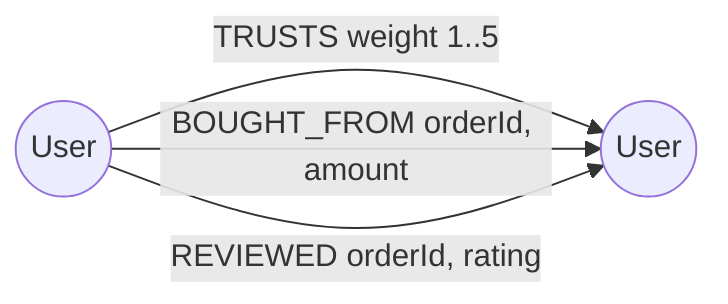
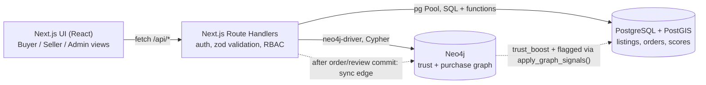

# Vicinia: Project Documentation

*DBMS Experiential Learning, Level 3. Team of 2.*

> Items marked **[TO FILL]** need real data from your own run (screenshots, test output, names). Everything else describes what is in this repository.

---

## 1. Problem Statement

General e-commerce platforms treat location as just another filter. For secondhand goods (furniture, electronics, appliances) location is the point: items are bulky, buyers want to inspect before paying, and delivery cost depends on distance. Buyers also need to trust a stranger they have never met. A simple average star rating is easy to game, and it ignores the social context ("a person I trust vouches for this seller").

Vicinia is a hyperlocal marketplace that treats **geography** and **trust** as two separate problems, each stored in the database best suited to it.

## 2. Objectives

1. Return "couches within 5 km, by distance, price and rating" using a real spatial index instead of brute-force distance maths.
2. Guarantee that two buyers can never both "win" the same one-off item (race-condition safety).
3. Compute a dynamic seller score (reviews, return rate, response time, network trust) that **changes search ranking**.
4. Model trust as a graph: trust propagates through connections, and suspicious closed buying clusters (collusion rings) are detected and demoted.
5. Offer pricing hints, delivery-time estimates by zone, and "people like you also bought from" recommendations.
6. Demonstrate *which database fits which problem*: PostGIS for location, relational integrity for transactions, a graph for trust.

## 3. Scope

**In scope:** registration/login with roles (Buyer, Seller, Admin); listings with location; proximity search with filters and ranking; purchase with concurrency control; order lifecycle (placed, delivered, returned); reviews; seller scoring; trust edges; collusion detection; admin dashboard; pricing hint; delivery estimate; recommendations.

**Out of scope:** real payments, image upload, real-time chat UI (messages exist in the schema and seed data and drive the response-time metric), map tiles, mobile apps.

## 4. Functional Requirements

| ID | Requirement | Role |
|---|---|---|
| F1 | Register / log in / log out; passwords hashed with bcrypt | All |
| F2 | Search listings within a radius by keyword, category, price range, minimum seller rating; sort by rank, distance, price | Buyer, Seller |
| F3 | View listing detail with seller score, reviews, delivery estimate and personal trust path | Buyer, Seller |
| F4 | Buy a listing; only one buyer can succeed | Buyer, Seller |
| F5 | Create, reprice, remove own listings | Seller |
| F6 | Mark orders delivered | Seller |
| F7 | Return a delivered order; review a delivered order | Buyer |
| F8 | Declare "I trust this seller" (graph edge) | Buyer, Seller |
| F9 | See pricing hint for own listing (demand vs supply nearby) | Seller |
| F10 | Recommendations: "buyers like you also bought from" | Buyer, Seller |
| F11 | Run collusion scan; view flagged sellers; take down their listings | Admin |
| F12 | View platform stats, seller leaderboard, category stats | Admin |

**Role access (enforced in every API route by `requireUser`):** Buyer and Seller can purchase; only Seller can create listings and see the seller dashboard; only Admin can use `/api/admin/*`.

## 5. ER Diagram

```mermaid
erDiagram
    USERS ||--o{ LISTINGS : "sells"
    USERS ||--o{ ORDERS : "buys (buyer_id)"
    USERS ||--o{ ORDERS : "sells (seller_id)"
    USERS ||--o| SELLER_METRICS : "has"
    USERS ||--o{ REVIEWS : "writes (reviewer_id)"
    USERS ||--o{ REVIEWS : "receives (seller_id)"
    USERS ||--o{ MESSAGES : "sends / receives"
    CATEGORIES ||--o{ LISTINGS : "classifies"
    CATEGORIES ||--o{ CATEGORIES : "parent of"
    LISTINGS ||--o| ORDER_ITEMS : "sold as"
    ORDERS ||--|{ ORDER_ITEMS : "contains"
    ORDERS ||--o| REVIEWS : "reviewed by"
    DELIVERY_ZONES ||--o{ ORDERS : "delivers within"
    LISTINGS ||--o{ MESSAGES : "discussed in"
    LISTINGS ||--o{ PRICE_HISTORY : "logs"

    USERS { bigint user_id PK
            varchar email UK
            text password_hash
            user_role role
            geography location }
    LISTINGS { bigint listing_id PK
               bigint seller_id FK
               int category_id FK
               numeric price
               listing_status status
               geography location
               tsvector search_vec }
    ORDERS { bigint order_id PK
             bigint buyer_id FK
             bigint seller_id FK
             order_status status
             numeric total_amount
             int zone_id FK }
    ORDER_ITEMS { bigint order_id PK_FK
                  bigint listing_id PK_FK_UK
                  numeric unit_price }
    REVIEWS { bigint review_id PK
              bigint order_id FK_UK
              smallint rating }
    SELLER_METRICS { bigint seller_id PK_FK
                     numeric seller_score
                     numeric trust_boost
                     boolean is_flagged }
    DELIVERY_ZONES { int zone_id PK
                     geography boundary }
```

**Graph model (Neo4j):**



## 6. Relational Schema

(PK = primary key, FK = foreign key, UK = unique.) Full DDL is in `db/postgres/01_schema.sql`.

```
users(user_id PK, name, email UK, password_hash, role, location, created_at, phone)
categories(category_id PK, name UK, parent_id FK→categories)
delivery_zones(zone_id PK, name UK, boundary, base_hours, per_km_hours)
listings(listing_id PK, seller_id FK→users, category_id FK→categories, title, description,
         price, condition, status, location, created_at, search_vec, view_count)
orders(order_id PK, buyer_id FK→users, seller_id FK→users, status, total_amount,
       zone_id FK→delivery_zones, est_hours, placed_at, delivered_at)
order_items(order_id PK/FK→orders, listing_id PK/FK→listings UK, unit_price)
reviews(review_id PK, order_id FK→orders UK, reviewer_id FK→users, seller_id FK→users,
        rating, comment, created_at)
messages(message_id PK, listing_id FK→listings, sender_id FK→users, receiver_id FK→users, body, sent_at)
seller_metrics(seller_id PK/FK→users, avg_rating, review_count, orders_total, orders_returned,
               avg_response_mins, trust_boost, seller_score, is_flagged, updated_at)
price_history(history_id PK, listing_id FK→listings, old_price, new_price, changed_at)
```

**Normalisation notes:** the tables are in 3NF. `seller_metrics` is a deliberate, trigger-maintained denormalisation (derived values) so that search ranking does not have to aggregate reviews, orders and messages on every query. `UNIQUE(listing_id)` on `order_items` encodes the business rule "a one-off secondhand item sells once" as a schema constraint.

**Constraints used:** `CHECK` (price > 0, rating 1..5, email format, title length, `buyer_id <> seller_id`, `orders_returned <= orders_total`, condition set), `NOT NULL`, `UNIQUE`, `FOREIGN KEY` with `ON DELETE CASCADE / SET NULL`, enumerated types for role/status.

## 7. Database Choice and Justification

| Data | Database | Why this one |
|---|---|---|
| Users, listings, orders, reviews, scores | **PostgreSQL** | Transactions, foreign keys, CHECK constraints, row-level locking. Money and inventory must be consistent. |
| Listing / user / zone locations | **PostGIS** (extension inside PostgreSQL) | GiST spatial index makes `ST_DWithin` and the `<->` nearest-neighbour operator index-assisted. The `geography` type gives distances in metres. Keeping it in the same database as listings means the location filter, price filter and rating filter run in one query plan. |
| Trust, "who bought from whom", collusion | **Neo4j** | Trust is relational: a score depends on paths between people. Multi-hop traversal and cycle detection are one `MATCH` pattern in Cypher; in SQL they need recursive CTEs with exponential self-joins. |

**Why not one database?** Putting trust in SQL would force recursive self-joins for cycle detection. Putting listings/transactions in a graph database would lose declarative constraints and the row-lock semantics needed for the purchase race. Each store does what it is best at, and the cost is a sync step (section 11).

## 8. Data Dictionary

### users
| Column | Type | Constraints | Description |
|---|---|---|---|
| user_id | BIGSERIAL | PK | Identifier (mirrored as `User.id` in Neo4j) |
| name | VARCHAR(100) | NOT NULL, length ≥ 2 | Display name |
| email | VARCHAR(255) | NOT NULL, UNIQUE, regex CHECK | Login |
| password_hash | TEXT | NOT NULL | bcrypt hash (never plain text) |
| role | user_role | NOT NULL, default buyer | buyer / seller / admin |
| location | GEOGRAPHY(Point,4326) | NOT NULL, GiST index | Home location |
| phone | VARCHAR(20) | CHECK format | Added via `ALTER TABLE` |
| created_at | TIMESTAMPTZ | NOT NULL | |

### listings
| Column | Type | Constraints | Description |
|---|---|---|---|
| listing_id | BIGSERIAL | PK | |
| seller_id | BIGINT | FK users, NOT NULL | Owner |
| category_id | INT | FK categories, NOT NULL | |
| title | VARCHAR(150) | NOT NULL, length ≥ 3 | |
| description | TEXT | NOT NULL | |
| price | NUMERIC(10,2) | CHECK > 0 | |
| condition | VARCHAR(20) | CHECK in (new, like_new, used, refurbished) | |
| status | listing_status | NOT NULL | active / reserved / sold / removed |
| location | GEOGRAPHY(Point,4326) | NOT NULL, GiST index | Item location |
| search_vec | TSVECTOR | GENERATED, GIN index | Full-text search over title + description |
| view_count | INT | CHECK ≥ 0 | Added via `ALTER TABLE` |

### orders / order_items
| Column | Type | Constraints | Description |
|---|---|---|---|
| order_id | BIGSERIAL | PK | |
| buyer_id, seller_id | BIGINT | FK users; CHECK buyer ≠ seller | |
| status | order_status | NOT NULL | placed / delivered / returned / cancelled |
| total_amount | NUMERIC(10,2) | CHECK > 0 | |
| zone_id, est_hours | INT, NUMERIC | FK delivery_zones | Delivery estimate captured at purchase |
| order_items.listing_id | BIGINT | PK part, FK, **UNIQUE** | An item can be sold once |

### reviews
`order_id` UNIQUE (one review per order), `rating` CHECK 1..5, `reviewer_id` / `seller_id` FKs. A `BEFORE INSERT` trigger checks that the reviewer is the buyer, the seller matches, and the order is delivered.

### seller_metrics
`avg_rating`, `review_count`, `orders_total`, `orders_returned`, `avg_response_mins` (derived from messages), `trust_boost` (0..100, pushed from Neo4j), `seller_score` (0..100), `is_flagged` (set by collusion detection). CHECK constraints bound every value.

### delivery_zones, categories, messages, price_history
See `01_schema.sql`. Zones hold a polygon boundary plus `base_hours` and `per_km_hours`.

### Neo4j
| Element | Properties | Notes |
|---|---|---|
| `(:User)` | `id` (unique constraint), `name`, `role`, `trustScore`, `flagged` | `id` mirrors `users.user_id` |
| `[:TRUSTS]` | `weight` 1..5, `since` | Explicit vouching |
| `[:BOUGHT_FROM]` | `orderId` (indexed), `amount`, `at` | One edge per order |
| `[:REVIEWED]` | `orderId`, `rating`, `at` | Reviewer to seller |

Indexes: unique constraint on `User.id`, index on `User.flagged`, relationship index on `BOUGHT_FROM.orderId`.

## 9. SQL / NoSQL Implementation

| File | Contents |
|---|---|
| `db/postgres/01_schema.sql` | `CREATE`, `ALTER`, `DROP`; PKs/FKs; constraints; GiST/GIN/partial/composite indexes; 3 views + 1 materialised view |
| `db/postgres/02_functions.sql` | Scoring function, 6 triggers, `purchase_listing` (row lock), `set_order_status` (procedure), `search_nearby`, `estimate_delivery`, `pricing_hint`, `apply_graph_signals` |
| `db/postgres/03_seed.sql` | Bengaluru seed data, 10 users, 19 listings, 9 orders, 3 zones, plus a planted collusion ring (users 8, 9, 10) |
| `db/postgres/queries/queries.sql` | Important queries and DML demos |
| `db/neo4j/01_schema_seed.cypher` | Constraints, indexes, seed graph |
| `db/neo4j/02_queries.cypher` | Trust, collusion, recommendation queries |

**Advanced features demonstrated (requirement: at least 4):**

1. **Transactions with row-level locking:** `purchase_listing` uses `SELECT ... FOR UPDATE`; the API runs it inside `BEGIN ISOLATION LEVEL ...`.
2. **Triggers:** score recalculation on review/order change; price history; review integrity; block re-opening sold listings; auto-create seller metrics.
3. **Stored functions/procedures:** scoring, purchase, search, delivery, pricing, `set_order_status` (a `PROCEDURE`).
4. **Spatial indexing:** GiST index with `ST_DWithin` and KNN `<->`.
5. **Views and materialised view:** search, order summary, leaderboard, demand grid.
6. **Full-text search:** generated `tsvector` + GIN.
7. **Graph traversal / aggregation (Neo4j):** multi-hop trust, cycle detection, co-purchase recommendation.

### Concurrency control (the "two buyers" problem)
`purchase_listing` locks the listing row with `FOR UPDATE`. Buyer B's transaction **blocks** at that line until A commits, then re-reads `status = 'sold'` and fails with a clean error (HTTP 409). `UNIQUE(order_items.listing_id)` is a second safety net at schema level.
Under `READ COMMITTED` (default) the row lock alone serialises the contested row. Under `REPEATABLE READ` / `SERIALIZABLE` the loser receives a serialization failure (`40001`), which the API also maps to 409. The `isolation` parameter of `POST /api/orders` lets you demonstrate all three.

### Seller score
```
rating_part = ((avg_rating * n + 3.0 * 5) / (n + 5)) / 5 * 100      -- shrinks toward neutral for few reviews
return_part = 100 * max(0, 1 - 2 * return_rate)                     -- 50% returns -> 0
resp_part   = 100 * clamp((1440 - avg_response_mins) / 1430, 0, 1)  -- 24h -> 0; no data -> 50
trust_part  = trust_boost                                            -- from Neo4j, 0..100
score       = 0.40*rating + 0.25*return + 0.20*response + 0.15*trust   (x0.25 if flagged)
```
Search rank = `0.6 * seller_score/100 + 0.4 * (1 - distance/radius)`, so a trusted seller slightly farther away can outrank a stranger next door.

### Graph trust and collusion detection
* **Personalised trust (viewer to seller):** paths up to 3 `TRUSTS` hops; each hop multiplies `weight/5` and halves per extra hop; combined as `100 * (1 - e^(-Σ))`. Flagged users are ignored.
* **Global trust boost:** weighted count of incoming `TRUSTS` from unflagged users, weighted more if the truster is trusted themselves, squashed with `100 * raw / (raw + 2)`, pushed to `seller_metrics.trust_boost`.
* **Collusion ring:** a simple closed `BOUGHT_FROM` cycle (length 2 to 4) among sellers where **no outside user ever bought from any member**. Members are flagged; their trust weight is removed and their score multiplied by 0.25.

## 10. Important Queries

See `db/postgres/queries/queries.sql` and `db/neo4j/02_queries.cypher`. Highlights:

```sql
-- Proximity search, spatial index + blended ranking (called by the API)
SELECT * FROM search_nearby(12.9784, 77.6408, 5000, NULL, NULL, 15000, NULL, 'couch', 'rank', 20);

-- Nearest-first KNN using the GiST index
SELECT listing_id, title, location <-> ST_SetSRID(ST_MakePoint(77.6408,12.9784),4326)::geography AS dist_m
FROM listings WHERE status='active' ORDER BY dist_m LIMIT 5;

-- GROUP BY / HAVING: highly rated sellers with very few distinct buyers (red flag)
SELECT o.seller_id, round(avg(r.rating),2), count(DISTINCT o.buyer_id)
FROM orders o JOIN reviews r ON r.order_id = o.order_id
GROUP BY o.seller_id HAVING avg(r.rating) >= 4.5 AND count(DISTINCT o.buyer_id) < 3;
```
```cypher
// Collusion ring: closed buying cycle with no outside buyers
MATCH (a:User)-[:BOUGHT_FROM]->(b:User)-[:BOUGHT_FROM]->(c:User)-[:BOUGHT_FROM]->(a)
WHERE a.id < b.id AND a.id < c.id
WITH [a,b,c] AS ring
WHERE NOT EXISTS { MATCH (x:User)-[:BOUGHT_FROM]->(m:User) WHERE m IN ring AND NOT x IN ring }
RETURN [m IN ring | m.id];
```

## 11. System Architecture



**Sync contract (PostgreSQL ⇄ Neo4j):**
* PostgreSQL is the source of truth for users, orders and reviews. After a purchase commits, the API creates the `BOUGHT_FROM` edge (`syncOrderToGraph`); after a review, the `REVIEWED` edge. Graph writes are non-fatal: if Neo4j is down the sale still succeeds and the response reports `graphSynced: false`.
* Graph-derived values flow back through `apply_graph_signals(seller, trust, flagged)`, which updates `seller_metrics` and recalculates the score.

**Security:** credentials only via environment variables (`.env`, git-ignored; `.env.example` committed); bcrypt password hashes; signed HTTP-only session cookie (JWT, HS256); all SQL parameterised (no string concatenation); Cypher parameterised; zod validation at the API plus CHECK/NOT NULL/UNIQUE/FK at the database; role checks on every protected route; login returns one message for unknown email and wrong password; users cannot self-register as admin.

## 12. Application Screenshots

**[TO FILL]** after running the app, capture: (1) login, (2) search results with filters, (3) listing detail with trust path and delivery estimate, (4) seller dashboard with score cards, (5) seller pricing hint, (6) My orders with deliver/return/review, (7) admin dashboard before the scan, (8) admin dashboard after the scan showing the flagged ring, (9) Neo4j Browser view of the ring (`MATCH p=()-[:BOUGHT_FROM]->() RETURN p`), (10) `EXPLAIN ANALYZE` showing the GiST index scan.

## 13. Testing Results

Test assets are included; **results must come from your own run [TO FILL]**.

| ID | Test | How to run | Expected | Result |
|---|---|---|---|---|
| T1–T11 | Spatial radius, sold items hidden, purchase + double purchase rejected, self-purchase rejected, review integrity, score changes on review/return, flagged demotion, CHECK constraints, price history, delivery estimate | `psql -f tests/sql_tests.sql` (rolls back) | 11 `PASS` notices | [TO FILL] |
| C1 | Two buyers, one item, simultaneous | `node --env-file=.env tests/concurrency.mjs` | exactly 1 winner | [TO FILL] |
| C2 | Same, repeated with `REPEATABLE READ` / `SERIALIZABLE` (change the list in the script) | same | 1 winner; loser gets `40001` or "no longer available" | [TO FILL] |
| G1 | Collusion scan on seed data | log in as admin, **Run collusion scan** | users 8, 9, 10 flagged; their scores drop to about a quarter | [TO FILL] |
| G2 | Trust propagation | log in as ravi, open a Divya listing, click "I trust this seller" | network trust shows a path; score rises | [TO FILL] |
| A1 | Auth/RBAC | buyer calls `POST /api/listings` | 403 | [TO FILL] |
| A2 | Auth/RBAC | anonymous calls `GET /api/orders` | 401 | [TO FILL] |
| A3 | Bad input | register with 3-char password | 400 with message | [TO FILL] |
| P1 | Index use | `EXPLAIN ANALYZE` of `ST_DWithin` query | `Index Scan using idx_listings_location`. With only ~19 rows the planner may choose a sequential scan; insert a few thousand rows or `SET enable_seqscan = off` to demonstrate it | [TO FILL] |

## 14. Conclusion and Future Enhancements

**Conclusion.** Vicinia shows that location, transactions, and trust are different data problems. PostGIS answers "what is near me" with an index; PostgreSQL guarantees an item can only be sold once; Neo4j answers "who do I trust and who is gaming the system" with graph patterns. The seller score connects the three: it is computed in SQL, boosted by graph trust, demoted by graph fraud detection, and consumed by spatial search ranking.

**Future work:** map UI (Leaflet) and image upload; real-time chat with a seller-reply UI; scheduled (cron) collusion scans and incremental trust updates using Neo4j Graph Data Science PageRank; an outbox table for reliable PostgreSQL-to-Neo4j sync instead of best-effort calls; vector embeddings (pgvector) for "similar items" semantic search; rate limiting and CSRF tokens; per-category dynamic pricing using `price_history` trends.

---

### Known limitations (be upfront about these in the demo)
* The Neo4j sync is best-effort (no outbox), so graph and SQL can drift if Neo4j is down during an order.
* Collusion detection only finds closed cycles with zero outside buyers; a ring that makes a few genuine sales would evade it. The threshold is a deliberate, explainable heuristic, not a proof.
* Delivery estimate is a linear model (`base + per_km * distance`), not real routing.
* The app was written and reviewed but **not executed end to end** in the authoring environment (no database or package registry access), so run the checklist in the README first and fix anything it exposes.
